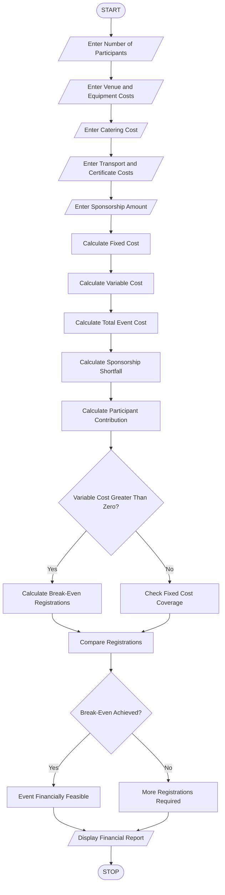

# 4. Campus Event Financial Planning System

## 1. Problem Statement

To develop a Python program that calculates campus event expenses, including venue, equipment, catering, transport, and certificate costs. The system determines participant contributions, sponsorship shortfalls, and the minimum number of registrations required to break even.

## 2. Algorithm

1. Start the program.
2. Enter the number of participants.
3. Enter venue cost.
4. Enter equipment cost.
5. Enter catering cost per participant.
6. Enter transport cost per participant.
7. Enter certificate cost per participant.
8. Enter available sponsorship amount.
9. Calculate total event expenses.
10. Calculate the amount covered by sponsorship.
11. Calculate the remaining amount to be collected.
12. Calculate participant contribution.
13. Calculate minimum registrations required to break even.
14. Display the total expenses and financial details.
15. Stop.

## 3. Flowchart



```
## 5. Sample Input

```
Enter number of participants: 100

Enter venue cost: 10000
Enter equipment cost: 5000

Enter catering cost per participant: 200
Enter transport cost per participant: 100
Enter certificate cost per participant: 50

Enter sponsorship amount: 15000
```

## 6. Sample Output

```
--- EVENT FINANCIAL REPORT ---

Fixed Cost: 15000.0
Variable Cost: 35000.0
Total Event Cost: 50000.0

Sponsorship: 15000.0
Sponsorship Shortfall: 35000.0

Participant Contribution: Rs. 350.0

Minimum Registrations to Break Even: 0

Current Participants: 100

Event is financially feasible.
```

Correction to the break-even calculation: Since sponsorship covers the fixed cost, the minimum registration count for this example is actually 0 for covering fixed costs alone. The participant fees cover the variable costs separately. If the goal is to recover the full event budget using sponsorship and registration fees, the calculation should instead use the participant contribution as a revenue amount.


## 8. Conclusion

Thus, the Campus Event Financial Planning System is implemented using Python. It calculates event expenses, participant contributions, sponsorship shortfalls, and the minimum registrations required to break even.
