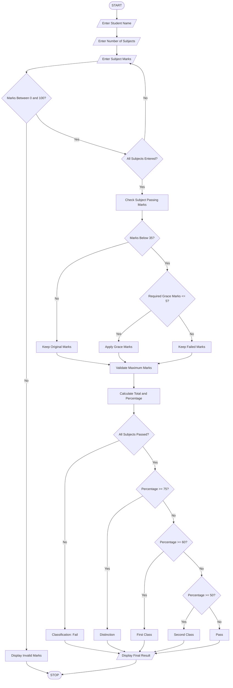

# 3. Examination Result and Grace-Mark Validation System

## 1. Problem Statement

To develop a Python program that processes student marks across multiple subjects, checks subject-wise passing criteria, applies grace marks according to a specified policy, and generates final results and classifications without exceeding maximum marks.

## 2. Algorithm

1. Start the program.
2. Enter the student's name and number of subjects.
3. Enter marks obtained in each subject.
4. Check the minimum passing marks for each subject (assume 35 out of 100).
5. If a student fails in a subject, check the grace-mark policy.
6. Allow a maximum of 5 grace marks per failed subject.
7. Apply grace marks only if the student can reach the passing mark.
8. Ensure final marks do not exceed 100.
9. Calculate total marks and percentage.
10. Generate the result:
    - 75% and above – Distinction.
    - 60% to 74% – First Class.
    - 50% to 59% – Second Class.
    - 35% to 49% – Pass.
    - Below 35% or any failed subject – Fail.
11. Display final marks and classification.
12. Stop.

## 3. Flowchart


```

## 5. Sample Input

```
Enter student name: Meghana
Enter number of subjects: 5

Enter marks for subject 1: 85
Enter marks for subject 2: 90
Enter marks for subject 3: 32
Enter marks for subject 4: 75
Enter marks for subject 5: 80
```

## 6. Sample Output

```
--- Result Processing ---

Subject 1
Original Marks: 85.0
Grace Marks: 0
Final Marks: 85.0

Subject 2
Original Marks: 90.0
Grace Marks: 0
Final Marks: 90.0

Subject 3
Original Marks: 32.0
Grace Marks: 3.0
Final Marks: 35.0

Subject 4
Original Marks: 75.0
Grace Marks: 0
Final Marks: 75.0

Subject 5
Original Marks: 80.0
Grace Marks: 0
Final Marks: 80.0

--- Final Examination Result ---

Student Name: Meghana
Total Marks: 365.0 / 500
Percentage: 73.0 %
Final Classification: First Class
```


## 8. Conclusion

Thus, the Examination Result and Grace-Mark Validation System is successfully implemented using Python. It checks subject-wise passing marks, applies grace marks, calculates percentages, and generates final classifications without exceeding maximum marks.

Note: The passing marks, grace-mark limit, and classification rules are assumed for this programming exercise. Actual university rules may differ.
