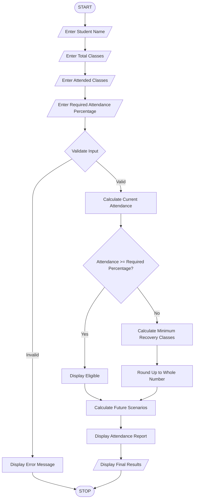

# 8. Attendance Recovery Computation System

## 1. Problem Statement

To develop a Python program that calculates students' current attendance percentages and determines the minimum number of consecutive classes they must attend to reach a required eligibility threshold under different future attendance scenarios.

## 2. Algorithm

1. Start the program.
2. Enter the student's name.
3. Enter total classes conducted.
4. Enter classes attended.
5. Enter the required attendance percentage.
6. Calculate current attendance percentage.
7. Check whether attendance meets the eligibility threshold.
8. If eligible, display the result.
9. Otherwise, calculate the minimum consecutive classes required using:

\\[ x = \frac{(T \times C)-A}{1-T} \\]

Where:

- A = Classes attended.
- C = Total classes conducted.
- T = Required attendance percentage (decimal).
- x = Additional consecutive classes to attend.

10. Round the result up to the next whole number.
11. Calculate attendance under different future scenarios.
12. Display current attendance and recovery details.
13. Stop.

## 3. Flowchart



## 5. Sample Input

```
Enter student name: Meghana

Enter total classes conducted: 100
Enter classes attended: 65
Enter required attendance percentage: 75
```

## 6. Sample Output

```
--- ATTENDANCE REPORT ---

Student Name: Meghana
Total Classes: 100
Classes Attended: 65
Current Attendance: 65.0 %

Status: Not Eligible
Minimum Consecutive Classes Required: 40

--- FUTURE ATTENDANCE SCENARIOS ---

After 5 classes: 66.67 %
After 10 classes: 68.18 %
After 15 classes: 69.57 %
After 20 classes: 70.83 %
```


## 8. Conclusion

Thus, the Attendance Recovery Computation System is successfully implemented using Python. It calculates current attendance, checks eligibility, determines the minimum consecutive classes required, and evaluates future attendance scenarios.

Note: This program assumes that the student attends every additional class and is not absent during the recovery period.
