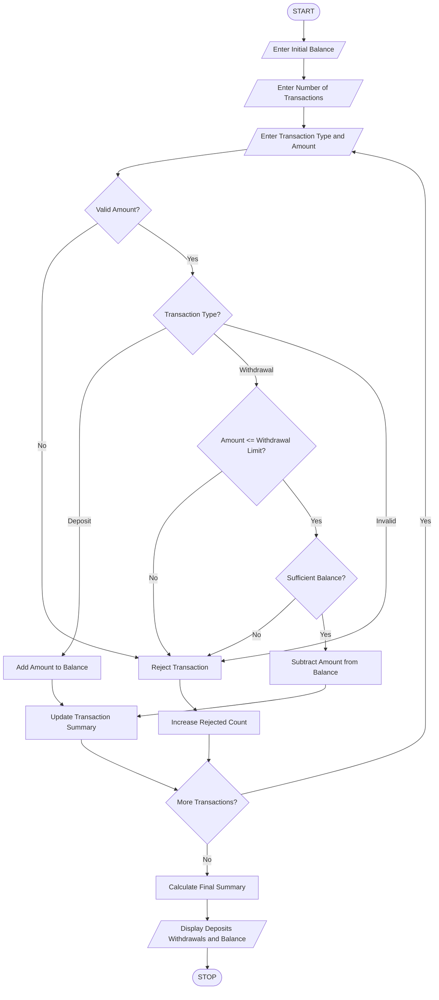

# 9. ATM Transaction Sequence Simulation

## 1. Problem Statement

To develop a Python program that simulates ATM transactions by processing multiple deposits and withdrawals. The system maintains the account balance, enforces withdrawal limits, rejects invalid transactions, and generates a final transaction summary.

## 2. Algorithm

1. Start the program.
2. Enter the initial account balance.
3. Enter the number of transactions.
4. Select the transaction type:
   - Deposit.
   - Withdrawal.
5. Enter the transaction amount.
6. Validate the transaction amount.
7. If the transaction is a deposit, add the amount to the balance.
8. If the transaction is a withdrawal:
   - Check sufficient balance.
   - Check the maximum withdrawal limit of ₹10,000 per transaction.
   - Process the withdrawal if valid.
9. Reject invalid transactions.
10. Repeat until all transactions are completed.
11. Display the final balance, total deposits, total withdrawals, and rejected transactions.
12. Stop.

## 3. Flowchart



## 5. Sample Input

```
Enter initial balance: 5000
Enter number of transactions: 4

Transaction 1
Enter transaction type (deposit/withdraw): deposit
Enter amount: 2000

Transaction 2
Enter transaction type (deposit/withdraw): withdraw
Enter amount: 3000

Transaction 3
Enter transaction type (deposit/withdraw): withdraw
Enter amount: 12000

Transaction 4
Enter transaction type (deposit/withdraw): withdraw
Enter amount: 1000
```

## 6. Sample Output

```
Transaction 1
Deposit Successful
Current Balance: Rs. 7000.0

Transaction 2
Withdrawal Successful
Current Balance: Rs. 4000.0

Transaction 3
Rejected: Withdrawal limit exceeded
Current Balance: Rs. 4000.0

Transaction 4
Withdrawal Successful
Current Balance: Rs. 3000.0

--- ATM TRANSACTION SUMMARY ---

Initial Balance: Rs. 5000.0
Total Deposits: Rs. 2000.0
Total Withdrawals: Rs. 4000.0
Rejected Transactions: 1
Final Balance: Rs. 3000.0

Thank you for using ATM!
```


## 8. Conclusion

Thus, the ATM Transaction Sequence Simulation is successfully implemented using Python. It processes deposits and withdrawals, maintains the account balance, enforces withdrawal limits, rejects invalid transactions, and displays the final transaction summary.

Note: The maximum withdrawal limit of ₹10,000 is an assumed value for this programming exercise.
