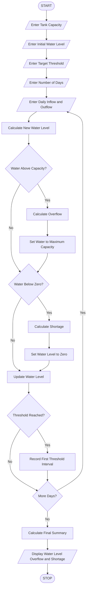

# 10. Multi-Day Water Tank Simulation

## 1. Problem Statement

To develop a Python program that simulates water tank levels over multiple days by processing changing water inflow and outflow quantities. The system updates water levels, detects overflow and water shortages, and identifies the first interval in which the tank reaches a specified threshold.

## 2. Algorithm

1. Start the program.
2. Enter the initial water level of the tank.
3. Enter the maximum tank capacity.
4. Enter the required water-level threshold.
5. Enter the number of days.
6. For each day:
   - Enter water inflow.
   - Enter water outflow.
   - Calculate the new water level.
7. If water exceeds tank capacity, detect overflow.
8. If water becomes negative, detect shortage.
9. Update the water level after each interval.
10. Check whether the specified threshold is reached for the first time.
11. Display daily water levels, overflow, shortages, and threshold information.
12. Stop.

## 3. Flowchart



## 5. Sample Input

```
Enter tank capacity in litres: 1000
Enter initial water level: 500
Enter target water level: 800
Enter number of days: 4

Day 1
Enter water inflow: 200
Enter water outflow: 100

Day 2
Enter water inflow: 300
Enter water outflow: 50

Day 3
Enter water inflow: 400
Enter water outflow: 100

Day 4
Enter water inflow: 100
Enter water outflow: 200
```

## 6. Sample Output

```
--- WATER TANK REPORT ---

Day 1
Overflow: 0 litres
Water Shortage: 0 litres
Current Water Level: 600.0 litres

Day 2
Overflow: 0 litres
Water Shortage: 0 litres
Current Water Level: 850.0 litres
Target Threshold Reached!

Day 3
Overflow: 250.0 litres
Water Shortage: 0 litres
Current Water Level: 1000.0 litres

Day 4
Overflow: 0 litres
Water Shortage: 0 litres
Current Water Level: 900.0 litres

--- FINAL WATER TANK SUMMARY ---

Final Water Level: 900.0 litres
Total Overflow: 250.0 litres
Total Shortage: 0 litres
First Threshold Reached on Day: 2
```


## 8. Conclusion

Thus, the Multi-Day Water Tank Simulation is successfully implemented using Python. It calculates changing water levels, detects overflow and shortages, and identifies the first day on which the specified water-level threshold is reached.

Note: The program assumes that inflow and outflow occur within each daily interval and calculates the final water level after both are processed.
