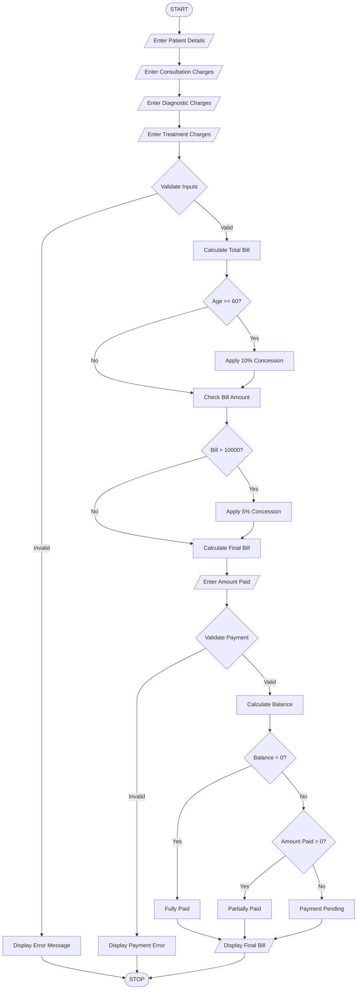

# 5. Hospital Billing and Patient Classification System

## 1. Problem Statement

To develop a Python program that calculates hospital bills based on consultation, diagnostic, and treatment charges. The system applies conditional concessions, validates billing constraints, calculates the final bill, and classifies patients according to the payment policy.

## 2. Algorithm

1. Start the program.
2. Enter patient name and patient type.
3. Enter consultation charges.
4. Enter diagnostic charges.
5. Enter treatment charges.
6. Calculate the total bill.
7. Apply concessions:
   - Senior citizens receive a 10% concession.
   - Patients with bills above ₹10,000 receive a 5% concession.
8. Validate that charges are not negative.
9. Calculate the final bill after concessions.
10. Classify payment status:
    - Full payment – Paid.
    - Partial payment – Partially Paid.
    - No payment – Pending.
11. Display the final bill and patient classification.
12. Stop.

## 3. Flowchart


## 5. Sample Input

```
Enter patient name: Meghana

Enter patient age: 65

Enter consultation charges: 1000
Enter diagnostic charges: 3000
Enter treatment charges: 8000

Enter amount paid: 8000
```

## 6. Sample Output

```
--- HOSPITAL BILL ---

Patient Name: Meghana

Consultation Charges: 1000.0
Diagnostic Charges: 3000.0
Treatment Charges: 8000.0

Total Bill: 12000.0
Concession: 1800.0
Final Bill: 10200.0

Amount Paid: 8000.0
Remaining Balance: 2200.0

Patient Classification: Partially Paid
```


## 8. Conclusion

Thus, the Hospital Billing and Patient Classification System is successfully implemented using Python. It calculates hospital charges, applies conditional concessions, validates payments, and classifies patients based on their payment status.

Note: The concession percentages and age criteria are assumed values for this programming exercise, not an actual hospital billing policy.
