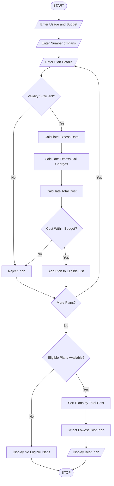

# 6. Multi-Plan Telecommunications Cost Optimization

## 1. Problem Statement

To develop a Python program that evaluates multiple mobile recharge plans based on data usage, call usage, validity, and budget constraints. The system calculates excess usage charges, compares the total costs of different plans, and identifies the most economical eligible plan.

## 2. Algorithm

1. Start the program.
2. Enter the user's data usage, call usage, and required validity.
3. Enter the user's budget.
4. Enter the number of mobile plans.
5. For each plan, enter:
   - Plan name.
   - Plan price.
   - Data limit.
   - Call limit.
   - Validity days.
   - Extra data charge per GB.
   - Extra call charge per minute.
6. Check whether the plan satisfies validity and budget constraints.
7. Calculate excess data and call charges.
8. Calculate the total plan cost.
9. Store all eligible plans.
10. Compare the total costs.
11. Identify the most economical eligible plan.
12. Display the plan details and total cost.
13. Stop.

## 3. Flowchart



## 5. Sample Input

```
Enter data usage in GB: 3
Enter call usage in minutes: 500
Enter required validity days: 28
Enter your budget: 400

Enter number of mobile plans: 3

Enter Plan 1 Details
Enter plan name: Plan A
Enter plan price: 199
Enter data limit in GB: 2
Enter call limit in minutes: 400
Enter validity days: 28
Enter extra data charge per GB: 20
Enter extra call charge per minute: 0.50

Enter Plan 2 Details
Enter plan name: Plan B
Enter plan price: 299
Enter data limit in GB: 5
Enter call limit in minutes: 600
Enter validity days: 56
Enter extra data charge per GB: 20
Enter extra call charge per minute: 0.50

Enter Plan 3 Details
Enter plan name: Plan C
Enter plan price: 149
Enter data limit in GB: 1
Enter call limit in minutes: 300
Enter validity days: 21
Enter extra data charge per GB: 20
Enter extra call charge per minute: 0.50
```

## 6. Sample Output

```
Plan not eligible: Insufficient validity

--- MOBILE PLAN COMPARISON ---

Plan Name: Plan A
Base Price: 199.0
Extra Data: 1.0 GB
Extra Calls: 100.0 minutes
Total Cost: Rs. 269.0

Plan Name: Plan B
Base Price: 299.0
Extra Data: 0 GB
Extra Calls: 0 minutes
Total Cost: Rs. 299.0

--- MOST ECONOMICAL PLAN ---

Plan Name: Plan A
Total Cost: Rs. 269.0
```


## 8. Conclusion

Thus, the Multi-Plan Telecommunications Cost Optimization System is successfully implemented using Python. It evaluates mobile plans based on usage, validity, and budget, calculates excess charges, and identifies the most economical eligible plan.

Note: The mobile plan prices and excess charges are assumed values for this programming exercise. Actual telecom tariffs may differ.
