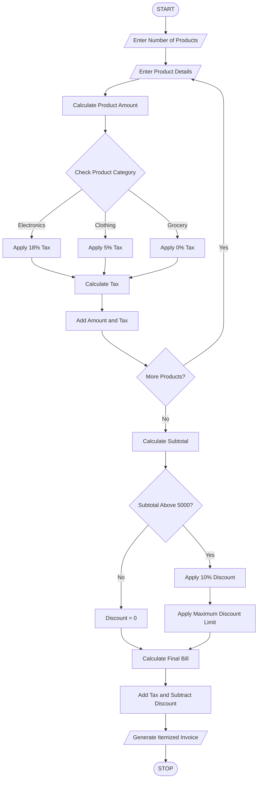

# 7. Retail Billing with Multiple Discount Rules

## 1. Problem Statement

To develop a Python program that processes multiple products and quantities, calculates category-specific taxes, applies threshold-based discounts, and enforces maximum concession limits to generate an itemized retail invoice with the final payable amount.

## 2. Algorithm

1. Start the program.
2. Enter the number of products.
3. Enter product name, category, price, and quantity.
4. Calculate the subtotal for each product.
5. Apply category-specific taxes:
   - Electronics – 18%.
   - Clothing – 5%.
   - Grocery – 0%.
6. Calculate the total subtotal.
7. Apply discounts:
   - 10% discount if subtotal is above ₹5,000.
   - Maximum discount limit is ₹1,000.
8. Calculate total tax.
9. Calculate the final bill after discount and tax.
10. Generate an itemized invoice.
11. Display the final payable amount.
12. Stop.

## 3. Flowchart



## 5. Sample Input

```
Enter number of products: 3

Enter Product 1 Details
Enter product name: Laptop
Enter category: electronics
Enter product price: 40000
Enter quantity: 1

Enter Product 2 Details
Enter product name: Shirt
Enter category: clothing
Enter product price: 1000
Enter quantity: 2

Enter Product 3 Details
Enter product name: Rice
Enter category: grocery
Enter product price: 500
Enter quantity: 2
```

## 6. Sample Output

```
========== RETAIL INVOICE ==========

Product: Laptop
Category: electronics
Price: 40000.0
Quantity: 1
Amount: 40000.0
Tax: 7200.0

Product: Shirt
Category: clothing
Price: 1000.0
Quantity: 2
Amount: 2000.0
Tax: 100.0

Product: Rice
Category: grocery
Price: 500.0
Quantity: 2
Amount: 1000.0
Tax: 0.0

Subtotal: 43000.0
Total Tax: 7300.0
Discount: 1000.0
Final Payable Amount: 49300.0

===================================
```


## 8. Conclusion

Thus, the Retail Billing System is successfully implemented using Python. It processes multiple products, calculates category-specific taxes, applies threshold discounts and maximum concession limits, and generates an itemized invoice.

Note: Tax rates and discount rules are assumed values for this programming exercise and are not official tax advice.
